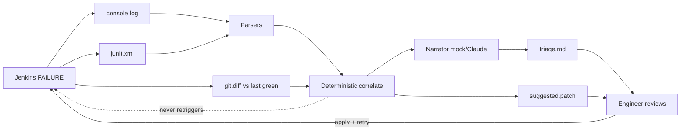

# Architecture — AI CI/CD Failure Triage

| Layer | Owns | Must not |
|---|---|---|
| Log / JUnit / diff parsers | What failed, where | Talk to the cluster |
| Correlate | Whether a cause exists | Invent a file that is not in the diff |
| LLM | Wording | Add causes, rebuild Jenkins |
| Human | Apply patch + retry the job | Skip the evidence |
